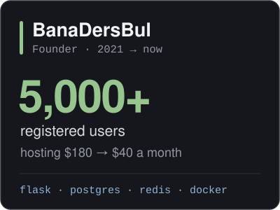
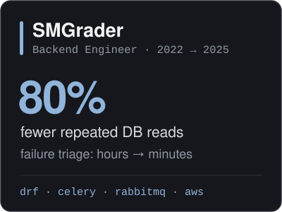
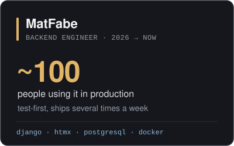

  <a href="https://burakuren.com">burakuren.com</a>&nbsp;&nbsp;·&nbsp;&nbsp;<a href="https://www.linkedin.com/in/burakuren/">LinkedIn</a>&nbsp;&nbsp;·&nbsp;&nbsp;<a href="mailto:contact@burakuren.com">contact@burakuren.com</a>

 

  
  
  

 

  

 

Production code lives in private repos. Open source: <a href="https://github.com/burakuren/my-website">my-website</a>, the source of burakuren.com.

